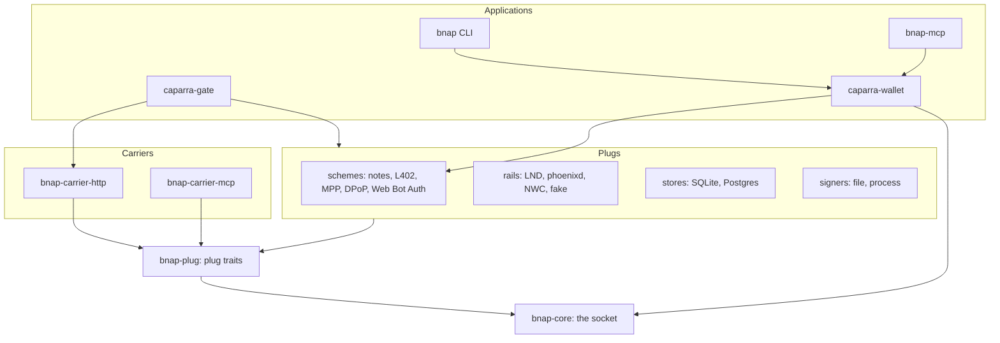

# Caparra

Caparra is the Rust reference implementation of BNAP, an open protocol for
priced and permissioned requests between machines over HTTP and MCP.

[](https://github.com/bnap-protocol/caparra/actions/workflows/ci.yml)
[](#license)
[](Cargo.toml)
[](https://bnap-protocol.github.io/caparra/)

> [!WARNING]
> Alpha (0.1.0-alpha), not audited, for regtest and testing only.
> Caparra tracks BNAP draft-00, nothing is published to crates.io, and
> every interface can change. Do not use it with mainnet money yet.

## What BNAP is

A server that wants to be paid, or wants proof of who is calling, answers
a request with HTTP 402 and a **signed offer**. The offer names the price,
the action it covers and the schemes the server accepts. The client
attaches one credential to the retried request. The server checks it,
records each payment as used **once only**, runs the action, and answers
with a **signed receipt**.

- **Offers** are signed with an online key that the origin lists in a
  manifest at `/.well-known/bnap`. The manifest is signed by an offline
  root key, and clients pin it.
- **Once-only uses.** One payment admits one action, even when the same
  Lightning payment is presented through several schemes.
- **Receipts** are signed with a separate receipt key and can be checked
  later by a third party.
- **Schemes are plugs.** The default is `bnap:notes`: blind ecash notes
  bought over Lightning, so the server does not learn which payment funded
  which request. L402 and MPP (`payment:lightning/charge`) are supported
  too, and DPoP and Web Bot Auth work as attestations that can waive or
  discount a price.

The specification lives in the
[bnap repository](https://github.com/bnap-protocol/bnap). The normative
text is `spec/socket-draft-00.md`.

## Quickstart

This puts `caparra-gate` in front of a local file server with one priced
path, using the fake rail, which moves no money. You need Rust (the
toolchain is pinned in `rust-toolchain.toml`), `protoc` (the LND rail
compiles `.proto` files), `curl` and Python 3. The first build takes a few
minutes; the rest takes about a minute.

```sh
git clone https://github.com/bnap-protocol/caparra.git
cd caparra
cargo build --locked -p caparra-gate -p bnap-cli -p bnap-mcp
export PATH="$PWD/target/debug:$PATH"

mkdir -p target/quickstart/www && cd target/quickstart
cp ../../examples/quickstart/gate.toml .
sh ../../examples/quickstart/setup.sh    # keys, keys.toml, then `caparra-gate manifest sign`
caparra-gate check --config gate.toml    # every start-up check, then exit
```

`setup.sh` creates the root, backup and online keys with
`caparra-gate key new` and signs the manifest with
`caparra-gate manifest sign --config gate.toml --root-key root.key --backup ... --seq 1 --keys-from keys.toml --out manifest.json`.
In production the root key stays offline; see
[`examples/llm-proxy`](examples/llm-proxy/README.md).

Start the service and the gate:

```sh
echo 'hello, paid world' > www/hello.txt
python3 -m http.server 9000 --bind 127.0.0.1 --directory www &
caparra-gate run --config gate.toml &
```

Look at what a client sees:

```sh
curl -s http://127.0.0.1:8080/.well-known/bnap   # the signed manifest
curl -si http://127.0.0.1:8080/hello.txt          # 402: a BNAP offer, plus L402 and Payment challenges
curl -s http://127.0.0.1:8080/                    # paths with no route pass through unpaid
```

Make a wallet with the `bnap` CLI and try to pay:

```sh
export BNAP_WALLET="$PWD/wallet.db" BNAP_PASSPHRASE='use a long passphrase'
bnap init                                         # shows the 12-word mnemonic once
bnap budget set --allow-experimental true --per-request 100
bnap budget show
bnap get http://127.0.0.1:8080/hello.txt
# error[BAD_INPUT]: Paid requests go over https only. Use an https:// URL.
```

The last command is refused on purpose: the wallet pays only over HTTPS,
and the gate does not terminate TLS. The fake rail's invoices can also be
paid only from inside the process that holds the rail. So the full paid
round trip on the fake rail (402, payment, admission, replay, `SPENT`,
receipt) runs in the test suite:

```sh
cargo test --locked -p caparra-gate --test gate --test notes
cargo test --locked -p caparra-wallet --test flows
```

To pay for real, put the gate behind a TLS proxy on a public HTTPS origin,
switch the rail to `lnd`, `phoenixd` or `nwc`, and give the wallet a pay
source (`bnap paysource nwc` or `bnap paysource command ...`). The
[guide](https://bnap-protocol.github.io/caparra/) has the details, and
`devenv/regtest/` runs the Lightning rails against a local regtest network
in Docker.

## Architecture

The protocol core (the socket) is one crate without I/O. Every plug point is
a Rust trait in `bnap-plug`, and the applications assemble the plugs an
operator picks.



Only `bnap-core` computes the OfferID, Context, Digest and ReplayKey,
compares value with price, commits uses and builds every message a signer
signs. A scheme gets a capped signer that can sign change up to the cap
`bnap-core` computed, and nothing more.

| Crate | Role | Status |
| --- | --- | --- |
| `bnap-core` | The socket: offers, credentials, receipts, manifest, use and outcome model, pricing; no I/O | Implemented, security reviewed |
| `bnap-plug` | Plug traits: scheme, rail, store, signer, carrier | Implemented, security reviewed |
| `bnap-scheme-notes` | `bnap:notes`: blind notes with change and funding inside the 402 | Implemented, security reviewed; no NUT HTTP endpoints in the gate yet |
| `bnap-scheme-l402` | `httpauth:L402` | Implemented, security reviewed |
| `bnap-scheme-mpp` | `payment:lightning/charge` (MPP) | Implemented, security reviewed |
| `bnap-scheme-dpop` | `httpauth:DPoP` and `httpauth:Bearer` attestations | Implemented, security reviewed; static keys only |
| `bnap-scheme-webbotauth` | `httpsig:web-bot-auth` attestation | Implemented, security reviewed; static directory only |
| `bnap-rail-lnd` | LND over gRPC | Implemented, regtest tested |
| `bnap-rail-phoenixd` | phoenixd | Implemented, tested against a stand-in |
| `bnap-rail-nwc` | Nostr Wallet Connect (NIP-47) | Implemented, unit tested only |
| `bnap-rail-fake` | In-memory rail for tests and local runs | Test only |
| `bnap-store-sqlite` | SQLite use store | Implemented, used by the gate |
| `bnap-store-postgres` | PostgreSQL use store | Implemented, not wired into the gate |
| `bnap-store-tests` | Suite every use store must pass | Test only, not published |
| `bnap-signer-file` | Signer with keys in a local key file | Implemented, security reviewed |
| `bnap-signer-process` | Signer in a separate process over a Unix socket (binary `bnap-signer`) | Implemented, security reviewed |
| `bnap-carrier-http` | BNAP in HTTP fields; a tower layer | Implemented, not yet security reviewed |
| `bnap-carrier-mcp` | BNAP in MCP tool calls (`PricedTools` around an rmcp server) | Library, security reviewed; not in the gate binary |
| `caparra-gate` | The gate: reverse proxy, Caddy `forward_auth` and nginx `auth_request` fronts | Implemented, not yet security reviewed; Envoy `ext_authz` refused at start |
| `caparra-wallet` | Client wallet: pins, policy and caps, notes, receipts, encrypted storage | Implemented, security reviewed |
| `bnap-cli` | The `bnap` command | Implemented, security reviewed |
| `bnap-mcp` | MCP server with three wallet tools for agents | Implemented, security reviewed |
| `e2e` | Tests across plugs, regtest Lightning with the `regtest` feature | Test only, not published |

"Security reviewed" means covered by [SECURITY-REVIEW.md](SECURITY-REVIEW.md),
an internal review with fuzzing, not an external audit.

## Use it with an AI agent

`bnap-mcp` is an MCP server over a `bnap` wallet. The model never picks a
scheme or sees a key: the wallet's policy and caps decide what is paid. It
has three tools:

| Tool | Arguments | What it does |
| --- | --- | --- |
| `fetch_paid` | `url`, `method?`, `body?`, `max_sat?` | Fetches an `https` URL and pays within the caps if the server asks |
| `budget` | `action?` (`get`, the default, or `set`), `cap?`, `sat?`, `origin?` | Shows the caps and what is left; `set` can only narrow a cap |
| `receipts` | `action?` (`list`, the default, or `verify`), `id?` | Lists receipts or verifies them as a third party would |

Make the wallet first (`bnap init`, `bnap budget set ...`,
`bnap paysource ...`), put the passphrase in a file with mode 0600, then
register the server with your MCP client. For clients that read an
`mcpServers` JSON configuration:

```json
{
  "mcpServers": {
    "bnap": {
      "command": "bnap-mcp",
      "args": [
        "--wallet", "/home/you/.bnap/wallet.db",
        "--passphrase-file", "/home/you/.bnap/passphrase"
      ]
    }
  }
}
```

`bnap-mcp` serves over stdio by default. `--http 127.0.0.1:PORT` serves
streamable HTTP at `/mcp` on a loopback address only, with no
authentication, so anyone who reaches it can spend within the caps. A new
wallet pays nothing until you opt in with
`bnap budget set --allow-experimental true`, because every scheme in the
registry is still experimental.

## Security model

- The gate refuses to start when a route cannot be satisfied, the manifest
  does not match its configuration, or the signer lacks the manifest's keys.
- Every payment is recorded as used once only, in one transaction. A replay
  gets the stored answer and a fresh receipt; it never runs the action
  again.
- Rails are trusted only for what they report as settled, in their own
  units. Keysend and AMP are refused.
- Online keys can sign offers and receipts only. The root key stays
  offline, and the signer can run as a separate user (`bnap-signer`).
- The wallet pays only over HTTPS, only after it has pinned the origin's
  manifest, and only within per-request, per-task, per-origin and daily
  caps that a model can narrow but never raise.

[SECURITY-REVIEW.md](SECURITY-REVIEW.md) records the internal review: no
HIGH, three MEDIUM findings fixed with regression tests, fifteen LOW findings
open. `caparra-gate` and `bnap-carrier-http` were out of its scope.
[KNOWN-ISSUES.md](KNOWN-ISSUES.md) lists every open LOW finding and the
open specification decisions. To report a vulnerability, follow
[SECURITY.md](SECURITY.md): use GitHub private vulnerability reporting, not
a public issue.

## Status and roadmap

**v0.5 (in progress, this workspace).** Done:

- The socket in `bnap-core`, checked against the reference test vectors
  of the specification.
- Compiled-in schemes `bnap:notes`, `payment:lightning/charge` and
  `httpauth:L402`; DPoP and Web Bot Auth as attestations.
- HTTP and MCP carriers; LND, phoenixd, NWC and fake rails; SQLite and
  Postgres stores; file and process signers.
- `caparra-gate`, `caparra-wallet`, `bnap` and `bnap-mcp`.
- Internal security review and fuzzing (twelve targets, run weekly).

Still open for v0.5: a security review of `caparra-gate` and
`bnap-carrier-http`, NUT HTTP endpoints for notes, metering of streamed
answers, Postgres in the gate, Envoy `ext_authz`, binary releases and the
items in [KNOWN-ISSUES.md](KNOWN-ISSUES.md).

**Planned, from the specification's roadmap:**

- **v0.6:** sidecar plugs over gRPC or HTTP; the x402 adapter; SASL and
  Nostr carriers; Ark and Fedimint rails; guarded fiat funding.
- **v0.7:** WASM component plugs; Privacy Pass, ARC and ACT schemes.

## Documentation

- The guide: <https://bnap-protocol.github.io/caparra/> (source in
  [`book/`](book/src/SUMMARY.md); build it with `mdbook build book`).
- The specification: <https://github.com/bnap-protocol/bnap>, rendered at
  <https://bnap-protocol.github.io/bnap/>.
- Examples: [`examples/`](examples/README.md).
- Changes: [CHANGELOG.md](CHANGELOG.md).

## Contributing

Pull requests go to `develop`. Every commit needs a DCO sign-off
(`git commit -s`), and CI runs the leak guard, rustfmt, clippy (pedantic,
warnings as errors), the tests on Linux and macOS, the MSRV check,
cargo-deny and the book. [CONTRIBUTING.md](CONTRIBUTING.md) has the
commands to run first. Questions and bugs go to
[GitHub issues](https://github.com/bnap-protocol/caparra/issues); this
project follows the [Code of Conduct](CODE_OF_CONDUCT.md).

## License

Licensed under either of [MIT](LICENSE-MIT) or [Apache-2.0](LICENSE-APACHE),
at your option. Unless you explicitly state otherwise, any contribution you
submit for inclusion is dual-licensed as above, without any additional terms
or conditions.
